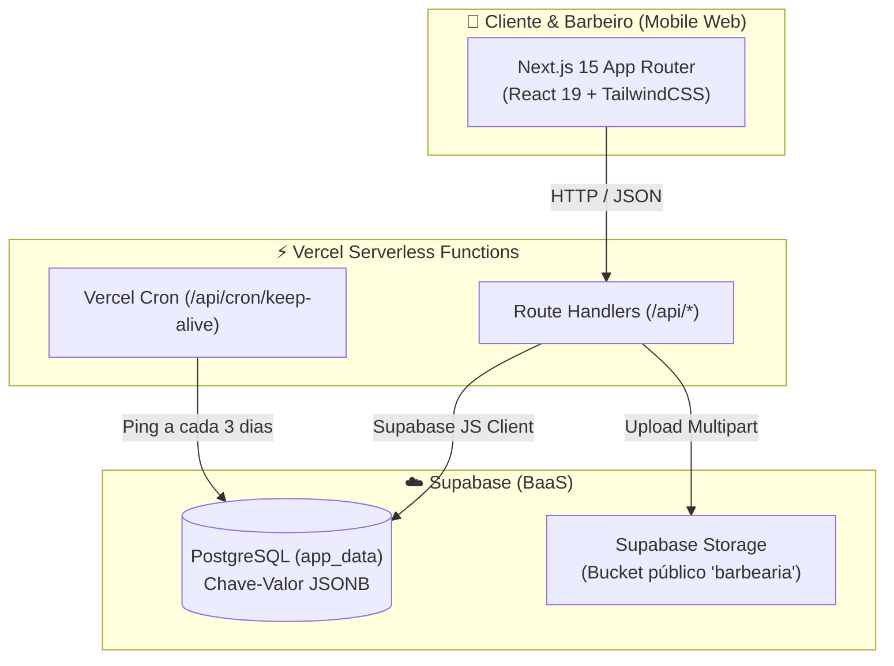

# 💈 barberQueue (Fila do Barbeiro)

> **Web App Mobile-First para gestão de fila em tempo real e intenção de horários para barbearias e pequenos negócios.**  
> Simples, rápido, acolhedor e sem necessidade de cadastro ou download de aplicativos pelos clientes.

[](https://nextjs.org/)
[](https://react.dev/)
[](https://www.typescriptlang.org/)
[](https://tailwindcss.com/)
[](https://supabase.com/)
[](https://vitest.dev/)
[](LICENSE)

---

## 💡 Pra quem é esse software? (A História & Propósito)

Sabe aquela dúvida clássica que todo mundo já teve:  
> *"Será que a barbearia tá lotada agora? Vou lá agora ou vou esperar 1 hora e meia sentado no sofá?"*

Criei esse aplicativo inicialmente visando **profissionalizar e aumentar o valor percebido de pequenos empreendedores e profissionais autônomos**. 

Usei um grande amigo barbeiro como piloto: cheguei nele, perguntei quais eram suas maiores dores no dia a dia, como funcionava a rotina da clientela e o que realmente facilitaria a vida dele. Com base no feedback real dele, nasceu o **barberQueue** (coloquei o nome em inglês porque soa mais chique kkk, mas a alma do projeto é 100% a boa e velha barbearia brasileira!).

A proposta é ser **simples, direto ao ponto e sem burocracia**:
- **Para o Cliente:** Não precisa baixar aplicativo pesado da Play Store/App Store, não precisa criar conta com senha, nem preencher formulários intermináveis. Ele abre o link pelo celular (geralmente direto da bio do Instagram ou WhatsApp), vê na hora se o barbeiro está atendendo ou em pausa de almoço, confere quantas pessoas estão aguardando na fila e pode marcar uma intenção de horário para os próximos dias em segundos.
- **Para o Barbeiro:** Traz organização e previsibilidade da semana sem engessar a rotina. Com um único toque no celular, ele atualiza a fila ao vivo e acompanha os agendamentos.

O projeto ainda está em versão beta, mas foi construído para ser leve, rápido e funcional. É aquela ferramenta acessível que agrega valor imediato para quem está começando ou expandindo seu próprio negócio!

---

## ✨ Principais Funcionalidades

### 📱 Experiência do Cliente (100% Focada em Celular)
- **Card "Ao Vivo" Inteligente:**
  - Mostra em tempo real quantas pessoas estão na barbearia no momento.
  - Detecta e avisa automaticamente status especiais com base no horário de Brasília (`America/Sao_Paulo`):
    - 🟢 **Aberto:** Contador ativo com indicação de ordem de chegada.
    - 🍽️ **Horário de Almoço:** Aviso amigável com a previsão de retorno.
    - 🚪 **Expediente Encerrado:** Informa o horário em que fechou e quando reabrirá, convidando o cliente a escolher um horário no calendário.
    - 🏖️ **Dias Bloqueados ou Folgas (ex: Domingo):** Mensagem de descanso com recado personalizado do barbeiro.
- **Intenção de Horários (14 Dias):**
  - Calendário deslizante horizontal com transições táteis fluidas para escolher o dia.
  - Seleção de horários disponíveis livres (slots de 1h calculados dinamicamente excluindo almoço e agendamentos já preenchidos).
  - Confirmação sem atrito: o cliente só digita seu nome e é direcionado ao WhatsApp da barbearia com uma mensagem pronta e formatada.
- **Links Rápidos e Informações:**
  - Botões diretos para WhatsApp, Instagram, rotas no Google Maps e bio personalizada.
  - Paleta de cores dinâmica que reflete a identidade visual configurada pelo barbeiro.

### 🛡️ Painel Administrativo do Barbeiro (`/admin`)
- **Acesso Seguro via PIN:** Protegido por código numérico de 4 a 6 dígitos em sessão.
- **Controle Tátil da Fila:** Botões ergonômicos gigantes de `+`, `-` e `Zerar Fila` com feedback de vibração no smartphone (Vibration API).
- **Gestão da Agenda:**
  - Visualização dos agendamentos por dia ou pela semana inteira.
  - Botão de **Compartilhar no WhatsApp**: gera um resumo formatado da agenda do dia em 1 clique para colar no status ou enviar aos clientes.
  - Cancelamento individual de agendamentos.
- **Bloqueio de Dias Específicos:** Permite fechar um dia de feriado ou imprevisto, cancelando agendamentos e exibindo um aviso para os clientes remarcarem.
- **Configuração de Horários da Semana:** Horário de abertura, fechamento e intervalo de almoço configuráveis individualmente de Segunda a Domingo.
- **Upload Direto de Imagens:** Troca de foto de perfil e banner de fundo com sobrescrita direta em nuvem (Supabase Storage).
- **Personalização de Cores e Bio:** Seletor de cores em tempo real (fundo e destaque dourado) que atualizam o tema de todos os clientes sem precisar rebuildar o app.

---

## 🏛️ Arquitetura Técnica



### Decisões de Arquitetura:
1. **Camada de Persistência Híbrida (`src/lib/storage.ts`):**
   - **Em Produção:** Armazena os dados na tabela `app_data` do Supabase usando chave-valor JSONB (`profile`, `queue`, `schedule`, `blocked_days`, `appointments`).
   - **Em Testes / Offline:** Chaveia automaticamente para persistência isolada em memória/disco sem necessidade de conexão externa (`NODE_ENV === 'test'`), mantendo a suíte de testes 100% verde e rodando em menos de 2 segundos.
2. **Supabase Storage para Imagens:**
   - Evita o erro clássico de `EROFS: read-only file system` em plataformas serverless (AWS Lambda / Vercel). Os uploads de avatar e banner vão direto para o bucket público do Supabase com quebra de cache via timestamp.
3. **Vercel Cron Keep-Alive (`/api/cron/keep-alive`):**
   - O Supabase pausa projetos no plano gratuito após alguns dias de inatividade. Configuramos um Cron nativo da Vercel (`vercel.json`) que envia um ping a cada 3 dias, garantindo que o banco permaneça sempre ativo sem depender de serviços externos pagos.

---

## 📁 Estrutura do Projeto

```text
barbearia/
├── src/
│   ├── app/
│   │   ├── admin/page.tsx             # Painel administrativo do barbeiro
│   │   ├── api/
│   │   │   ├── admin/                 # Rotas administrativas (auth, bloqueios, uploads, etc.)
│   │   │   ├── appointments/          # Criação e consulta de agendamentos
│   │   │   ├── calendar/              # Geração de slots de 14 dias
│   │   │   ├── cron/keep-alive/       # Rota ping para o Vercel Cron
│   │   │   ├── profile/               # Perfil e tema da barbearia
│   │   │   └── queue/                 # Fila em tempo real
│   │   ├── globals.css                # Estilos globais e normalizações para iOS WebKit
│   │   ├── layout.tsx                 # Layout global, metadata mobile e créditos
│   │   └── page.tsx                   # Página principal pública do cliente
│   ├── components/                    # Ícones SVG e ThemeInjector (CSS Variables)
│   ├── lib/
│   │   ├── storage.ts                 # Adaptador de persistência híbrido e lógica de horários
│   │   └── supabase.ts                # Inicialização do cliente Supabase (Público e Admin)
│   └── types/index.ts                 # Tipagens completas do TypeScript
├── supabase/
│   └── schema.sql                     # Script SQL de 1 clique para criar tabelas, storage e dados mock
├── tests/                             # 29 testes automatizados com Vitest
├── vercel.json                        # Configuração do Cron Job da Vercel
├── .env.example                       # Modelo de variáveis de ambiente
└── package.json
```

---

## 🚀 Como Clonar e Configurar o Seu Próprio

Siga o passo a passo abaixo para rodar o projeto localmente ou fazer seu próprio deploy em produção:

### 1. Pré-requisitos
- **Node.js** 18.17 ou superior instalado.
- Conta gratuita no [Supabase](https://supabase.com).
- Conta gratuita na [Vercel](https://vercel.com) (para deploy).

---

### 2. Clonar o Repositório e Instalar Dependências

```bash
# Clone o repositório
git clone https://github.com/Mathz36/barberQueue.git

# Acesse a pasta do projeto
cd barberQueue

# Instale as dependências
npm install
```

---

### 3. Configurar o Banco no Supabase (Setup de 1 Clique)

1. Crie um novo projeto gratuito no painel do [Supabase](https://database.new).
2. No menu lateral esquerdo, vá em **SQL Editor**.
3. Abra o arquivo [`supabase/schema.sql`](supabase/schema.sql) deste repositório, copie todo o seu conteúdo e cole no SQL Editor.
4. Clique em **Run** (Executar).
5. O script irá criar automaticamente:
   - A tabela `app_data` com as políticas de acesso seguras (RLS).
   - O bucket público de imagens `barbearia`.
   - As permissões para upload de fotos.
   - Os dados iniciais de demonstração (perfil modelo, horários e fila zerada).

---

### 4. Configurar as Variáveis de Ambiente

No painel do Supabase, vá em **Project Settings** -> **API** e copie:
- `Project URL`
- `anon public` key
- `service_role` key (mantenha esta chave secreta!)

Crie um arquivo `.env.local` na raiz do seu projeto (baseado no [`.env.example`](.env.example)):

```bash
cp .env.example .env.local
```

Preencha os valores no seu `.env.local`:

```env
NEXT_PUBLIC_SUPABASE_URL=https://seu-projeto.supabase.co
NEXT_PUBLIC_SUPABASE_ANON_KEY=sua-chave-anon-aqui
SUPABASE_SERVICE_ROLE_KEY=sua-chave-service-role-aqui

# Token de segurança para o Cron da Vercel (opcional, pode manter o padrão)
CRON_SECRET=barbearia_keep_alive_secret_2026
```

---

### 5. Executar Localmente

```bash
# Inicie o servidor de desenvolvimento
npm run dev
```

Abra [http://localhost:3000](http://localhost:3000) no seu navegador ou acesse pelo celular na mesma rede Wi-Fi!

- **Página do Cliente:** `http://localhost:3000`
- **Painel do Barbeiro:** `http://localhost:3000/admin`  
  *(O PIN padrão mockado no script é `1234`)*

---

### 6. Executar a Bateria de Testes

O projeto conta com **29 testes automatizados** cobrindo regras de negócio, limites de agendamento, concorrência, status de horário e cálculos de fuso:

```bash
npm test
```

---

### 7. Como Fazer Deploy na Vercel (Produção Gratuita)

1. Suba o seu repositório para o seu próprio GitHub.
2. Acesse a [Vercel](https://vercel.com) e clique em **Add New Project** -> importe o repositório.
3. Na seção **Environment Variables**, adicione as mesmas variáveis do seu `.env.local`:
   - `NEXT_PUBLIC_SUPABASE_URL`
   - `NEXT_PUBLIC_SUPABASE_ANON_KEY`
   - `SUPABASE_SERVICE_ROLE_KEY`
   - `CRON_SECRET`
4. Clique em **Deploy**.
5. Pronto! O app estará no ar com HTTPS gratuito, persistência em nuvem e o Vercel Cron ativado automaticamente pelo arquivo `vercel.json`.

---

## 🔒 Segurança e Privacidade

- **Row Level Security (RLS):** Leitura pública restrita estritamente aos dados de exibição da barbearia, enquanto mutações administrativas exigem autenticação via Service Role.
- **Sanitização de Inputs:** Validação de schemas e formatos de data/hora no backend para prevenção de concorrência ou dados malformados.

---

## 👨‍💻 Autor & Créditos

Desenvolvido por **[mathz36](https://github.com/mathz36)**.

Se este projeto te ajudou ou foi útil para o seu negócio ou estudos, deixe uma ⭐️ no repositório! Dúvidas, sugestões e pull requests são sempre bem-vindos.

---

*Licença MIT - Sinta-se livre para usar, modificar e distribuir para ajudar pequenos negócios locais.* 🚀
